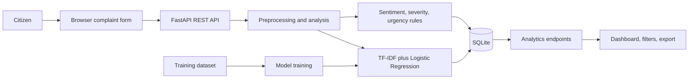
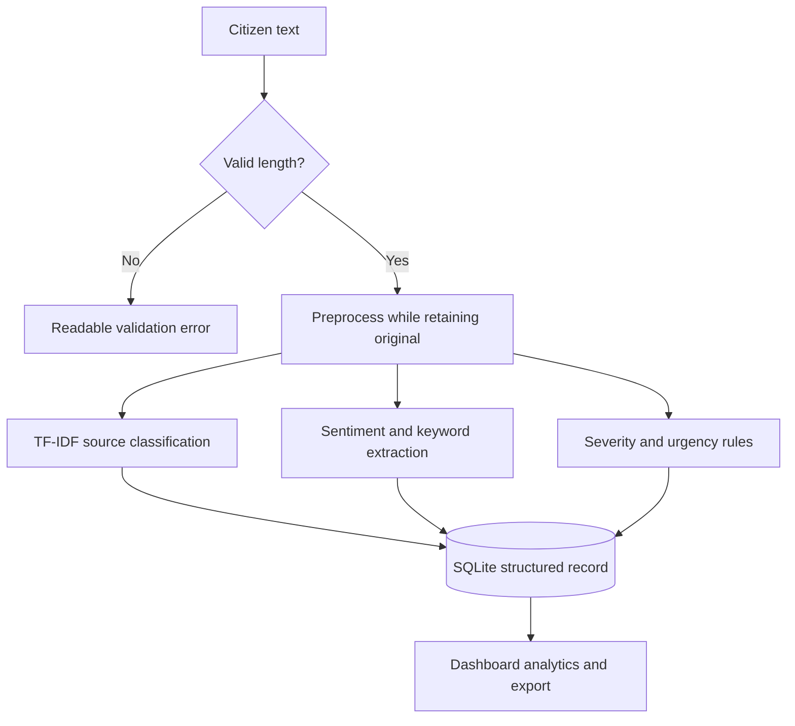

# Project Report: Noise Pollution Analytics

## Abstract
This academic prototype applies traditional NLP and supervised classification to synthetic citizen reports about urban noise. It structures free text into likely source, sentiment, estimated severity, urgency and keywords, stores reports locally, and exposes aggregate analytics for civic decision support.

## Introduction and problem statement
Noise complaints arrive as unstructured text. Manual review makes reports difficult to search, compare and aggregate. This project demonstrates an understandable local pipeline converting those reports to structured signals. It does not determine legal violations or represent government data.

## Existing and proposed system
A manual register offers little classification or aggregation. The proposed browser application combines a citizen form, transparent NLP, a TF-IDF source model, SQLite storage and an admin dashboard.

## Objectives and scope
Classify likely noise sources; expose language and urgency signals; group synthetic complaints by area and time; export records; make the analysis explainable during a viva. No real personal data or mapping service is used.

## Architecture


## Functional and non-functional requirements
Submit and analyze complaints, search/filter/list/detail, provide aggregate endpoints, and export CSV. The prototype runs locally, validates requests, reports concise errors and supports mobile layouts.

## Dataset
`data/noise_complaints.csv` has 504 synthetic examples balanced over nine source categories. Phrase templates vary urban contexts and wording. The seed script loads 150 demo records. This dataset is suitable for an academic demonstration, not field-performance claims.

## NLP methodology and preprocessing
Text is lowercased and regex-tokenized; punctuation and digits do not become tokens. A small stopword list removes common function words while preserving negation and intensity terms. A transparent suffix/irregular mapping approximates lemmatization. Both raw and processed complaint text are stored.

## TF-IDF and model
TF-IDF weights terms based on their frequency in the current report and rarity over the training corpus. Unigram and bigram features are input to multiclass Logistic Regression. A stratified 80/20 split and fixed random seed produce repeatable evaluation. Scores are not calibrated probabilities.

## Sentiment, severity and urgency
Sentiment uses a compact positive/negative word lexicon, with neutral as a baseline; complaint language naturally skews negative. Severity is an AI estimate from explicit intensity, duration, sleep and sensitive-location phrases. Urgency is a transparent flag from criticality and selected night-time/context cues. These are not official standards.

## Database and API design
SQLite stores complaints and a minimal users table. Complaint fields include original/processed text, predictions and scores, keywords, date/time and area/location. FastAPI provides complaint analysis/create/list/detail, demo auth, analytics, health and CSV export. See `api-documentation.md` and `/docs`.

## Complaint flow


## ER diagram
```mermaid
erDiagram
 COMPLAINTS { int id PK string name string email string location string area string complaint_text string processed_text string noise_source string sentiment float sentiment_score string severity float severity_score boolean is_urgent string keywords date date time datetime created_at }
 USERS { int id PK string name string email string password string role }
```

## Results
Training calculates accuracy, macro precision/recall/F1, per-class report and confusion matrix on the held-out split. `model-results.md` is generated by training and should be read alongside the dataset limitations.

## Limitations and future scope
Generated English examples are not representative of natural multilingual reports. Lexical sentiment and severity may miss negation/context; source confidence is uncalibrated. Future work could evaluate consented anonymized reports, expand local-language support, calibrate models, and add production-grade access controls and usability review.

## Conclusion
The prototype demonstrates the engineering contribution of converting unstructured citizen complaints into structured intelligence using explainable NLP and presenting the result as decision support.

## References
1. Salton, G. and Buckley, C. (1988), Term-weighting approaches in automatic text retrieval.
2. Manning, C. D., Raghavan, P. and Schütze, H. (2008), Introduction to Information Retrieval.
3. scikit-learn User Guide: feature extraction and linear models.
4. FastAPI documentation.
